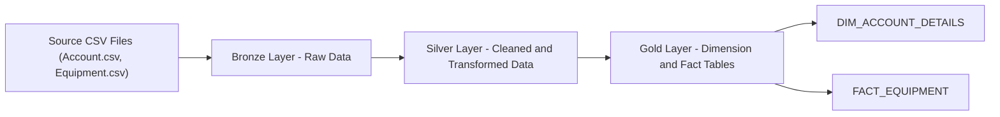
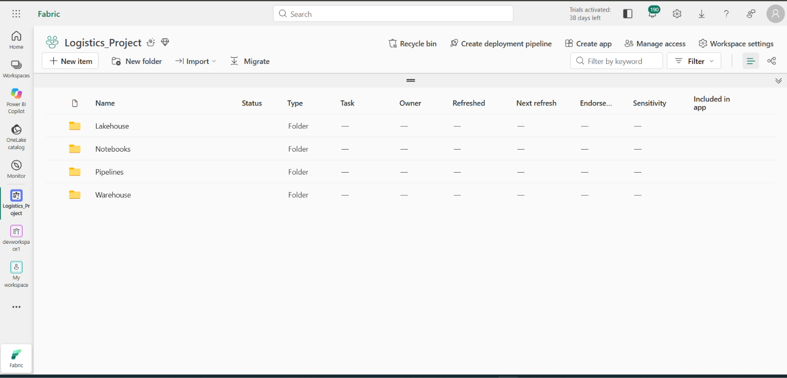
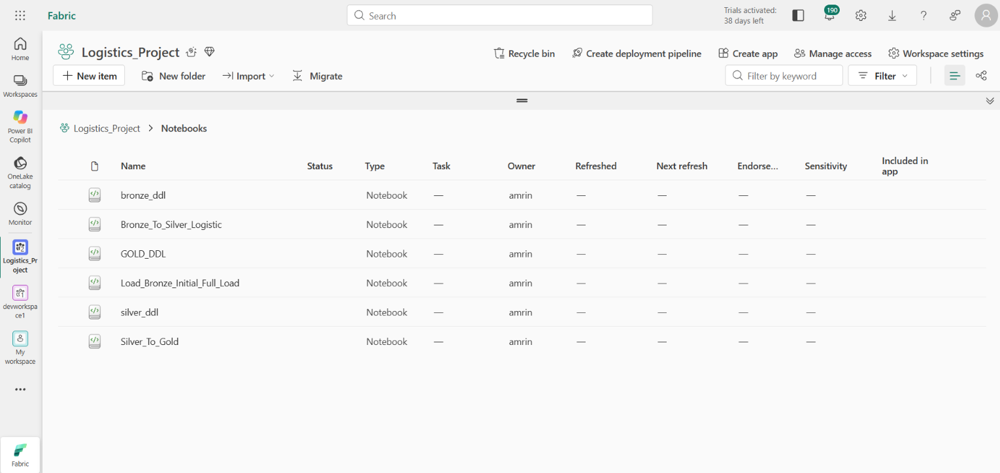
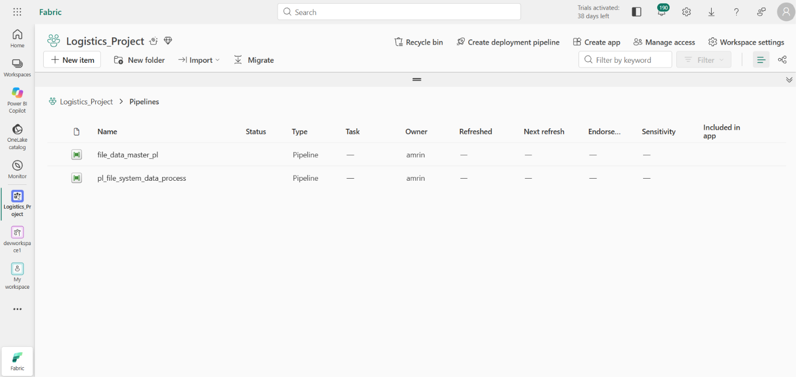
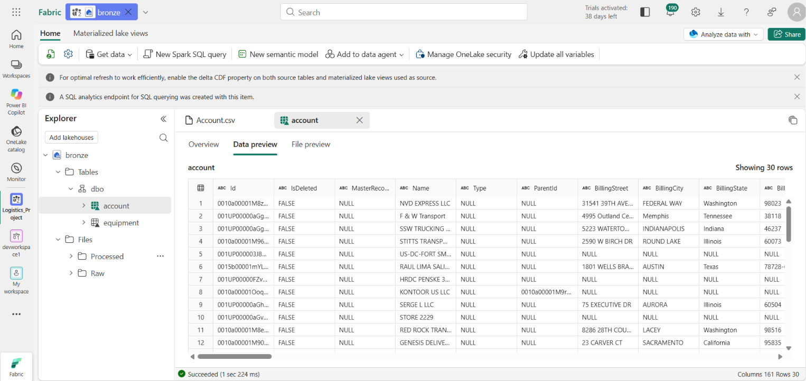
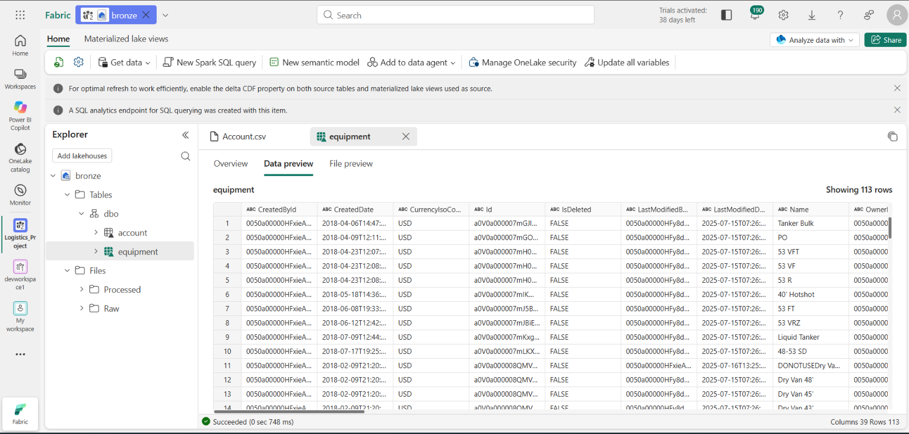
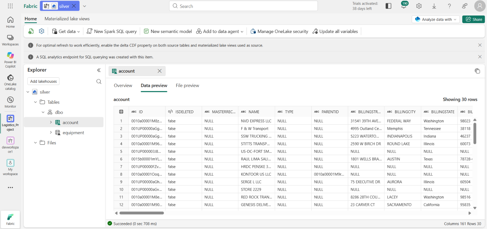
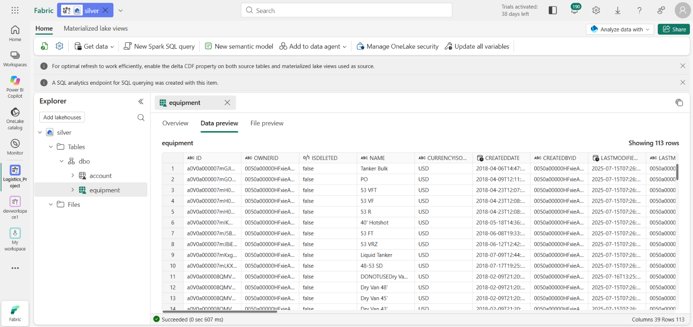
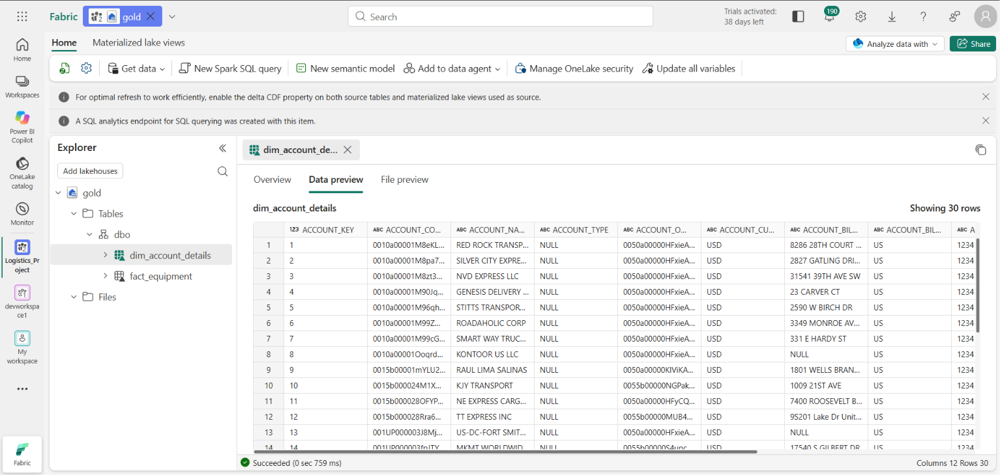
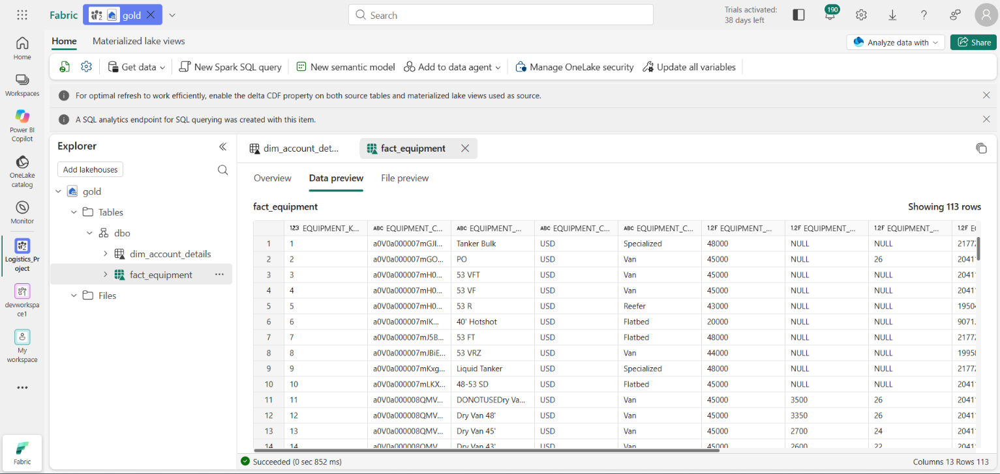

Logistics Data Engineering Project – Microsoft Fabric

📌 Project Overview

This project demonstrates an end-to-end logistics data engineering workflow using Microsoft Fabric. It focuses on ingesting, transforming, and organizing logistics data through the Medallion Architecture.

🎯 Project Objectives

- Ingest raw logistics data into the Bronze layer.
- Clean and transform data in the Silver layer.
- Prepare structured dimension and fact tables in the Gold layer.
- Organize data processing through Microsoft Fabric notebooks and pipelines.

🏗️ Project Architecture

The project follows the Medallion Architecture:

**Bronze → Silver → Gold**



- **Bronze:** Stores raw Account and Equipment data.
- **Silver:** Applies data cleaning, column mapping, null handling, and data type conversion.
- **Gold:** Organizes transformed data into dimension and fact tables for analytics.
  
🛠️ Technologies Used

- Microsoft Fabric
- PySpark
- SQL
- Fabric Lakehouse
- Fabric Warehouse
- Fabric Notebooks
- Fabric Data Pipelines
- Medallion Architecture

🔄 Implementation Workflow

1. Configured the Microsoft Fabric workspace and project components.
2. Created configuration tables for source objects.
3. Ingested Account and Equipment CSV files into the Bronze layer.
4. Transformed Bronze data into Silver tables.
5. Created and populated Gold dimension and fact tables.
6. Used notebooks and pipelines to organize the data processing workflow.

📊 Data Objects

Layer| Data Objects
Bronze| Account, Equipment
Silver| Account, Equipment
Gold| DIM_ACCOUNT_DETAILS, FACT_EQUIPMENT

📸 Project Screenshots

## 📸 Project Screenshots

### 1. Workspace Overview


### 2. Notebooks Overview


### 3. Pipelines Overview


### 4. Bronze Layer

**Account Table**



**Equipment Table**



### 5. Silver Layer

**Account Table**



**Equipment Table**



### 6. Gold Layer

**Dimension Table – DIM_ACCOUNT_DETAILS**



**Fact Table – FACT_EQUIPMENT**



## 📊 Project Output Summary

| Layer | Account Records | Equipment Records |
|---|---:|---:|
| Bronze | 30 | 113 |
| Silver | 30 | 113 |
| Gold | 30 | 113 |

📁 Repository Structure

```text
Logistics_Project/
│
├── Lakehouses/
│   ├── Bronze
│   ├── Silver
│   └── Gold
│
├── Notebooks/
│   ├── bronze_ddl
│   ├── Load_Bronze_Initial_Full_Load
│   ├── Bronze_To_Silver_Logistic
│   ├── silver_ddl
│   ├── GOLD_DDL
│   └── Silver_To_Gold
│
├── Pipelines/
│   └── Data Processing Pipelines
│
└── Warehouse/
    └── DW
```
🎯 Key Learnings

Through this project, I gained practical exposure to:

- Implementing Medallion Architecture using Microsoft Fabric.
- Loading raw CSV data into a Bronze Lakehouse.
- Transforming and cleaning data using PySpark.
- Working with Silver and Gold data layers.
- Creating dimension and fact tables.
- Using Microsoft Fabric notebooks and pipelines.
- Understanding end-to-end data engineering workflows.

👩‍💻 Author

Tuba Qureshi

"LinkedIn Profile" (https://www.linkedin.com/in/tuba-qureshi/)


