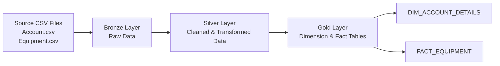

Logistics Data Engineering Project – Microsoft Fabric

📌 Project Overview

This project demonstrates an end-to-end logistics data engineering workflow using Microsoft Fabric. It focuses on ingesting, transforming, and organizing logistics data through the Medallion Architecture.

🎯 Project Objectives

- Ingest raw logistics data into the Bronze layer.
- Clean and transform data in the Silver layer.
- Prepare structured dimension and fact tables in the Gold layer.
- Organize data processing through Microsoft Fabric notebooks and pipelines.

🏗️ Architecture

The project follows the Medallion Architecture:

Bronze → Silver → Gold

- Bronze: Stores raw Account and Equipment data.
- Silver: Applies data cleaning, column mapping, null handling, and data type conversion.
- Gold: Organizes transformed data into dimension and fact tables for analytics.

🛠️ Technologies Used

- Microsoft Fabric
- PySpark
- SQL
- Fabric Lakehouse
- Fabric Warehouse
- Fabric Notebooks
- Fabric Data Pipelines
- Medallion Architecture

🔄 Implementation Workflow

1. Configured the Microsoft Fabric workspace and project components.
2. Created configuration tables for source objects.
3. Ingested Account and Equipment CSV files into the Bronze layer.
4. Transformed Bronze data into Silver tables.
5. Prepared Gold dimension and fact table structures.
6. Used notebooks and pipelines to organize the data processing workflow.

📊 Data Objects

Layer| Data Objects
Bronze| Account, Equipment
Silver| Account, Equipment
Gold| DIM_ACCOUNT_DETAILS, FACT_EQUIPMENT

📚 Key Learnings

- Understanding Medallion Architecture.
- Working with Lakehouse and Warehouse components.
- Performing data transformations using PySpark.
- Using configuration tables for metadata-driven processing.
- Understanding data pipeline orchestration in Microsoft Fabric.

👩‍💻 Author

Tuba Qureshi
linkedin.com/in/tuba-qureshi

📸 Project Screenshots

1. Workspace Overview

"Workspace Overview" (screenshots/workspace-overview.png)

2. Notebooks

"Notebooks Overview" (screenshots/notebooks-overview.png)

3. Pipelines

"Pipelines Overview" (screenshots/pipelines-overview.png)

4. Bronze Layer

Account Table

"Bronze Account" (screenshots/bronze-account.png)

Equipment Table

"Bronze Equipment" (screenshots/bronze-equipment.png)

5. Silver Layer

Account Table

"Silver Account" (screenshots/silver-account.png)

Equipment Table

"Silver Equipment" (screenshots/silver-equipment.png)

6. Gold Layer

Dimension Table – DIM_ACCOUNT_DETAILS

"Gold Dimension" (screenshots/gold-dim-account-details.png)

Fact Table – FACT_EQUIPMENT

"Gold Fact" (screenshots/gold-fact-equipment.png)
